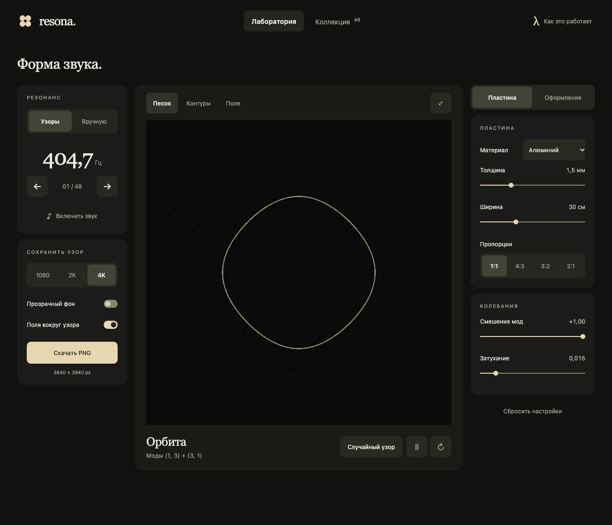

# Resona Lab

An interactive Chladni pattern lab. Explore how plate geometry, material and excitation affect its modal response, then export the resulting sand patterns as PNG.

[Open the lab](https://resona-lab.vercel.app/) · [Download the source](https://github.com/blvgor/resona-lab/archive/refs/heads/main.zip)



## Explore

- Choose from 48 presets, browse the collection or generate a different pattern at random.
- Change the material, thickness, width and aspect ratio of the plate.
- Adjust mode blending and damping, enter a frequency or sweep through resonances.
- Switch between moving sand, contours and the displacement field. Pause or scatter the particles again.
- Set particle density, size, spread, exposure and colours; optionally play a sine tone at the selected frequency.
- Export PNG images at 1080, 2160 or 3840 pixels on the long side, with optional margins and transparency.

The lab runs in the browser. Settings are saved on your device; accounts, API keys and external services are not required. The interface is currently in Russian.

## Run locally

Requires Node.js 20 or newer. Download and extract the source, open a terminal in the project folder, then run:

```sh
npm start
```

Open **http://127.0.0.1:4178**. There are no packages to install. The local server binds to this computer only; press Ctrl+C to stop it. `RESONA_PORT` sets an alternative port.

On macOS, `start.command` also starts the server and opens the lab.

## Build and test

```sh
npm test
npm run build
```

The build copies the five browser assets into `public/`, ready for a static host. `vercel.json` includes the same build and output settings for Vercel.

Six tests cover nodal-ring stability, thin-plate frequency scaling, supported boundaries, all 48 presets, manual-frequency response and saved-state validation.

## Model and limitations

The plate is a simply supported, rectangular, isotropic Kirchhoff–Love plate. Its analytical modes are:

```text
phi_mn(x,y) = sin(m*pi*x/a) * sin(n*pi*y/b)
D = E*h^3 / (12*(1-nu^2))
f_mn = pi/2 * sqrt(D/(rho*h)) * ((m/a)^2 + (n/b)^2)
```

Here, `a` and `b` are plate dimensions, `h` is thickness, `E` is Young's modulus, `rho` is density and `nu` is Poisson's ratio. Presets combine the modes `(m,n)` and `(n,m)`. Manual tuning evaluates 81 modes under point excitation and renders the 16 strongest contributions.

Particle movement is an artistic approximation of accumulation near low-amplitude regions. Free edges, arbitrary plate shapes and a calibrated physical installation are outside this model. Material parameters are representative values, and the calculated frequencies have not been validated against a real apparatus.

WebGL renders the particles, with a Canvas fallback. A 3840-pixel export is 3840 × 3840 for a square plate and 3840 × 1920 at 2:1.

## Credits

The main visual and functional reference is [Resonant by Nika Teiler](https://resonant.xntaylerx.workers.dev/). Its source code, font files and artwork were not copied.

Model references: [analytical thin-plate modes, University of Louisiana](https://math.louisiana.edu/sites/math/files/DuongNguyenPosterSIAMTXLA.pdf) and [rectangular plate frequencies, Nigerian Journal of Technology](https://nijotech.com/index.php/nijotech/article/view/1282).

Additional interface references: [RITM on Pinterest](https://www.pinterest.com/pin/3870349673186505/) and [Austensor on Awwwards](https://www.awwwards.com/sites/austensor-ai-webgl-art).

## License

[MIT](LICENSE). Built by [Egor Belyakov](https://github.com/blvgor).
